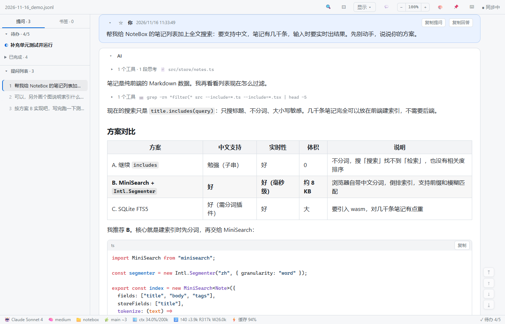
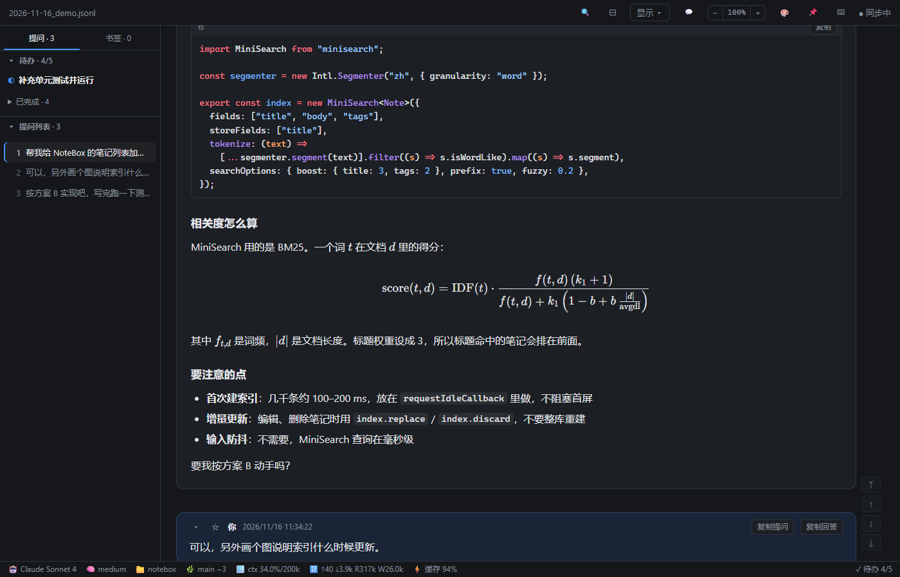
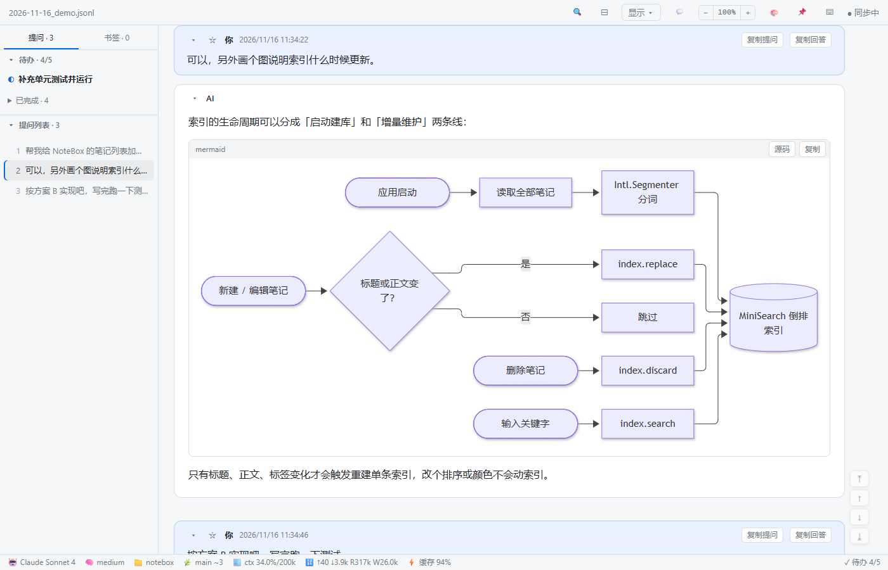
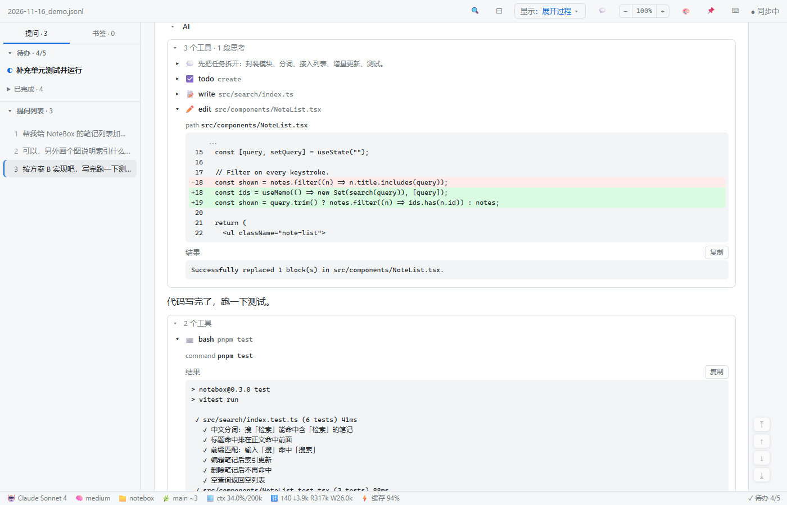
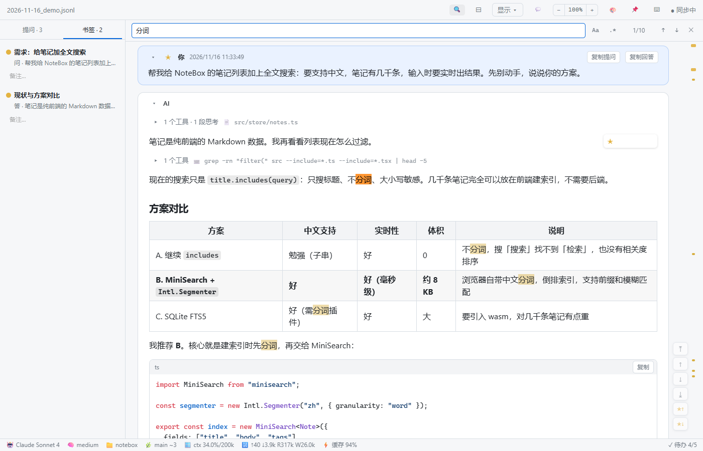

<div align="center">

# show-me-plz

**给 [pi](https://github.com/earendil-works/pi) 用的会话阅读器**
在独立窗口里实时、只读地展示当前对话：折叠噪音、渲染 Markdown / 代码 / 公式 / 图表，读长会话不再费劲。

[](LICENSE)
[](#安装)
[](https://tauri.app)
[](https://github.com/AstraNocturna/show-me-plz/releases)



</div>

## 为什么要有它

终端里读 AI 的长回答很累：表格被挤歪、公式是一堆符号、工具调用刷满屏幕，想回头找一句话只能一直往上翻。
show-me-plz 在旁边开一个只读窗口，**跟着当前会话实时更新**，让你专心读，主会话完全不受影响。

## 特性

- 🧹 **折叠噪音**：思考和工具调用默认收成一行，需要时点开；edit 步骤直接显示带行号的 diff
- 📖 **舒服地读**：Markdown、代码高亮、表格、图片、KaTeX 公式、mermaid 图表；6 套主题，字体、字号、颜色、宽度都能调
- 🧭 **好导航**：提问大纲、全文搜索（含折叠内容、支持正则）、书签（可命名，也能让 AI 起名）、滚动条标记
- 🔗 **文件可点**：回答里提到的本地文件变成链接，右侧分屏只读预览，直接跳到对应行；图片路径悬停即看
- 💬 **旁路问答**：读到不懂的地方，选中文字就能单独问，不打断主会话，还能复用主会话的提示缓存
- 📊 **状态一目了然**：底部状态栏对应终端 footer（模型、上下文占用、token、缓存命中率、git 分支），还有待办列表
- ⏸ **不错过确认**：终端在等你确认权限时，窗口顶栏会变成黄色提醒
- 🔒 **只读、零干扰**：插件不注册工具、不改提示词和上下文、不写会话文件

| 暗色主题与公式 | mermaid 图表 |
| :---: | :---: |
|  |  |
| **展开过程与 diff** | **搜索与书签** |
|  |  |

> 截图里的会话是为演示编写的示例，不是真实数据。

## 安装

**环境要求**

- Windows 10 / 11（需要 WebView2 运行时，Windows 11 自带；Windows 10 一般也已安装，没有的话[点此下载](https://developer.microsoft.com/microsoft-edge/webview2/)）
- [pi](https://github.com/earendil-works/pi)（在 1.5.2 上开发和测试）

目前只支持 Windows。

### 方式一：下载发行版（推荐）

1. 到 [Releases](https://github.com/AstraNocturna/show-me-plz/releases) 下载最新的 `show-me-plz-vX.Y.Z-windows-x64.zip`。
2. 解压到一个**固定的位置**，例如 `C:\tools\show-me-plz\`（之后不要移动，pi 会按这个路径找插件）。解压后是这样：

   ```
   show-me-plz\
   ├── show-me-plz.exe        阅读器程序
   └── extension\
       ├── index.ts           pi 插件（/viewer 命令）
       └── qa-guard.ts        旁路问答的只读保护
   ```

3. 告诉 pi 加载这个插件：打开 `~/.pi/agent/settings.json`（Windows 上是 `C:\Users\你的用户名\.pi\agent\settings.json`），在 `extensions` 数组里加上插件的**绝对路径**。JSON 里反斜杠要写成两个：

   ```json
   {
     "extensions": [
       "C:\\tools\\show-me-plz\\extension\\index.ts"
     ]
   }
   ```

   已经有别的扩展的话，把这一行加进现有数组里即可。
4. 重启 pi，或在 pi 里输入 `/reload`。
5. 输入 `/viewer`，阅读窗口就会打开并跟随当前会话。

> **Windows 提示「已保护你的电脑」？** 程序没有做代码签名，第一次运行 SmartScreen 可能拦截：点「更多信息」→「仍要运行」。源码都在这个仓库里，也可以自己构建。

**只想先试一下、不改配置？** 用 `-e` 临时加载，只对这一次 pi 生效：

```bash
pi -e C:\tools\show-me-plz\extension\index.ts
```

### 方式二：从源码构建

需要 Node.js、pnpm 和 Rust 工具链（MSVC）。

```bash
git clone https://github.com/AstraNocturna/show-me-plz.git
cd show-me-plz/app
pnpm install
pnpm tauri build --no-bundle   # 产物：app/src-tauri/target/release/show-me-plz.exe
```

然后和上面一样，在 `settings.json` 里加入仓库里 `extension/index.ts` 的绝对路径，`/reload` 后输入 `/viewer`。插件会自动找到上面的构建产物。

## 配置

| 项目 | 说明 |
| --- | --- |
| `settings.json` 的 `extensions` | 让 pi 加载本插件，见上文 |
| 环境变量 `SHOW_ME_PLZ_EXE` | 阅读器程序不在默认位置时，用它指定 `show-me-plz.exe` 的完整路径 |
| 窗口里的设置 | 主题、字体、缩放、置顶、显示方式等，在窗口顶栏调整，会自动记住，不需要改文件 |

插件按这个顺序找阅读器程序：`SHOW_ME_PLZ_EXE` → 插件文件夹的上一级（发行版的布局）→ 仓库里的构建产物。

**数据存在哪里**

- 书签：`%APPDATA%\com.astranocturna.showmeplz\marks\<会话 id>.json`
- 窗口偏好（主题、缩放等）：`%LOCALAPPDATA%\com.astranocturna.showmeplz\`
- 旁路问答的临时文件：`%TEMP%\show-me-plz-qa\`，关闭窗口或点「新问答」时清理

不写 pi 的任何文件，不改你的会话。

**卸载**：从 `settings.json` 的 `extensions` 里删掉那一行，再删除程序文件夹即可；想清掉数据就删上面两个目录。

## 快速上手

1. 在 pi 里正常对话，输入 `/viewer` 打开阅读窗口，它会实时跟随；再次输入会聚焦已打开的窗口。
2. 左侧「提问」是大纲，点一下跳转；「书签」里放你加的书签。右上「显示」菜单控制要不要看中间回复、思考和工具调用。
3. 想找东西点 🔍 搜索；想收藏某一段点提问卡片右上角的 ☆；想问 AI 就选中文字点「💬 问 AI」。
4. 所有功能都有按钮，快捷键只是可选的。

**每个功能怎么用，见 [使用说明](USAGE.md)。**

## 它会不会影响我的 pi？

- **不会影响主会话。** 插件不注册工具，不挂提示词和上下文钩子，不写会话文件。它只监听「开始 / 结束、思考 / 回复 / 工具调用」这类通知，并把这些告诉阅读器：当前模型、思考等级、上下文占用、pi 的启动位置和参数。阅读器只读取会话文件，不往里写。
- **关于费用：** 阅读、搜索、书签、预览都是本地操作，不耗 token。只有**旁路问答**和书签的**「AI 起名」**会另外启动一个 pi 子进程去问模型，这会消耗 token（会复用主会话的提示缓存，所以便宜，缓存过期后第一问会贵一些）。
- **旁路问答默认只读**，子代理只能读文件；打开「允许子代理修改」才可以改文件、执行命令，面板会显示红色警告。

## 已知限制

- 只支持 Windows 和 pi。
- 旁路问答的只读保护只拦截工具调用，拦不住扩展自己的行为；子代理需要加载全部扩展，首次启动要几十秒。
- 「等你确认」的提示只对 [pi-permission-system](https://github.com/gotgenes/pi-packages) 的确认框有效，其他扩展自己弹的对话框读不到。
- 待办只认 `rpiv-todo` 的数据格式，装了别的待办插件不会显示。
- 折叠状态不会保存，重开窗口后恢复默认。

## 开发

```bash
cd app
pnpm install
pnpm tauri dev          # 开发模式（带窗口，前端热更新）
pnpm test               # 单元测试
pnpm tauri build --no-bundle
```

- `app/` — Tauri 2 + React + TypeScript 阅读器
- `extension/` — pi 插件

## 许可证

[MIT](LICENSE) © 2026 AstraNocturna
